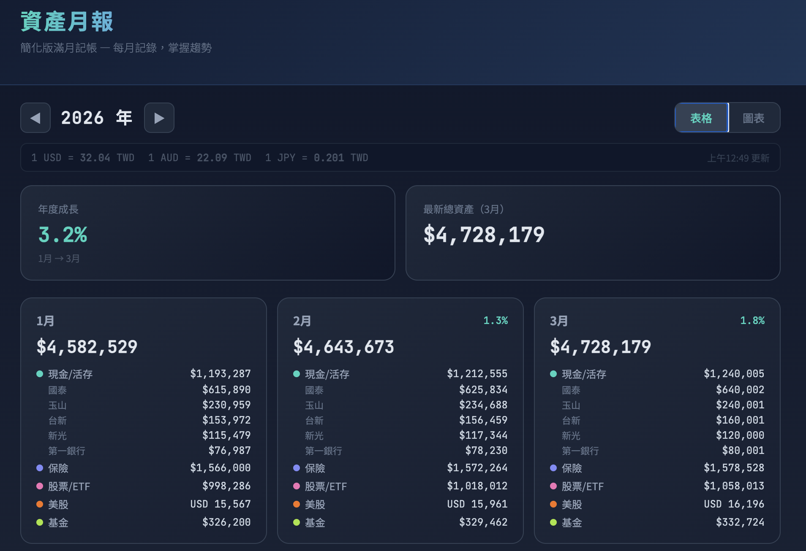
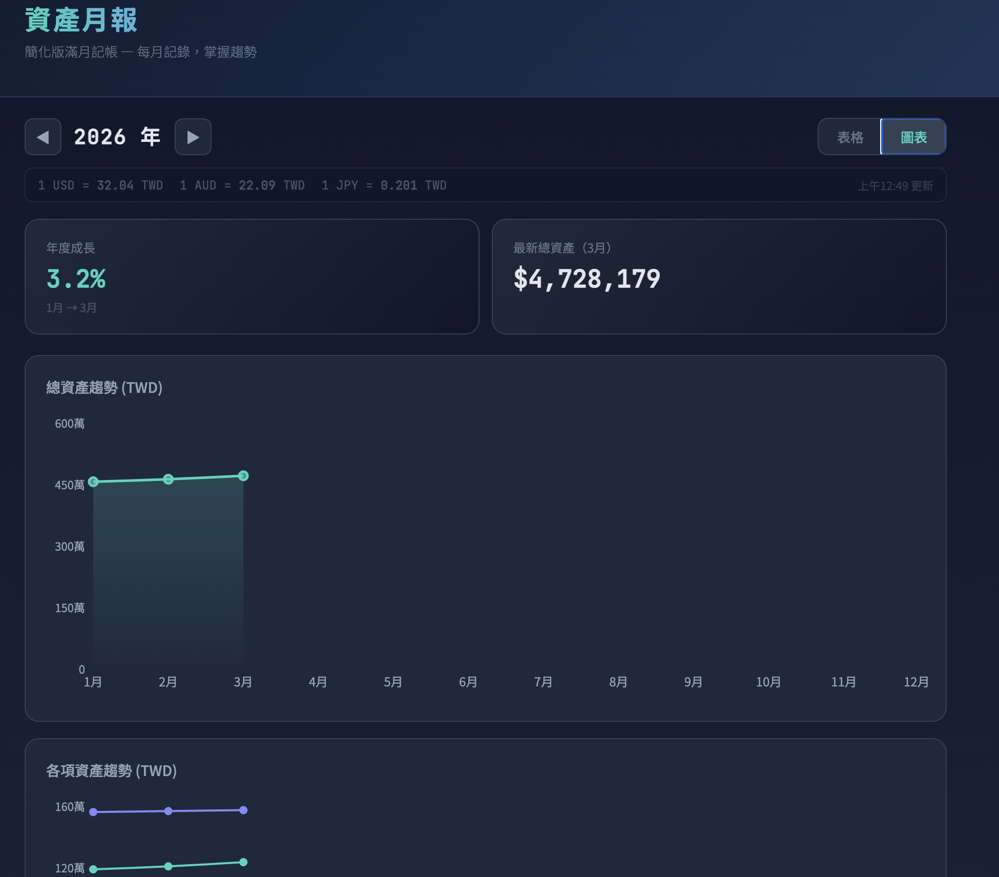

# 資產月報

個人資產追蹤工具 — 每月記錄、掌握趨勢。

Built with Vite + React + Cloudflare Pages + D1 (SQLite).

## Screenshots

**表格視圖**


**圖表視圖**


## Features

- 每月輸入各類資產金額，自動累計並呈現趨勢
- 現金支援多銀行帳戶，USD/AUD/JPY 匯率即時換算為 TWD
- 資產類別：現金/活存、保險、台股、美股、基金/ETF
- 表格視圖 + 折線圖視圖切換
- 資料儲存於 Cloudflare D1，雲端同步

## Development

```bash
npm install
npm run dev      # 本地開發 (Vite + Pages Functions + D1)
npm run build    # 建置至 dist/
npm run deploy   # 建置並部署至 Cloudflare Pages
```

詳細架構與部署說明見 [CLAUDE.md](CLAUDE.md)。
